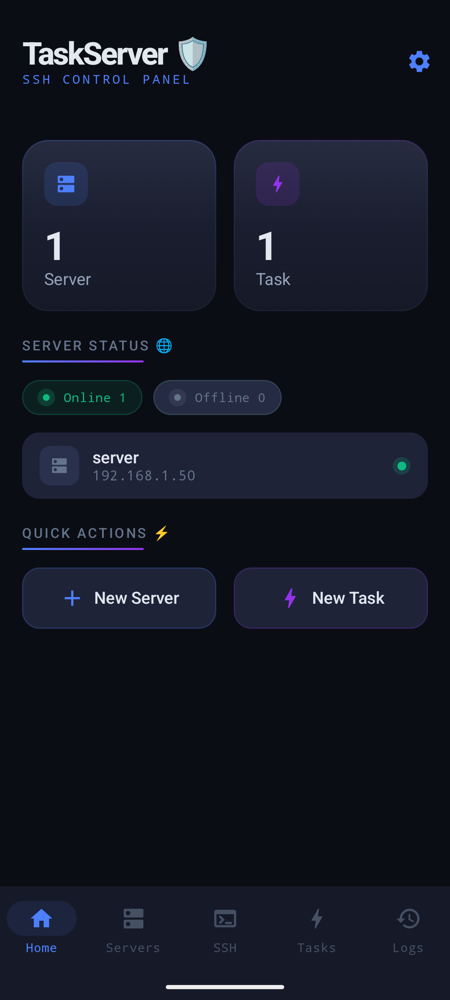
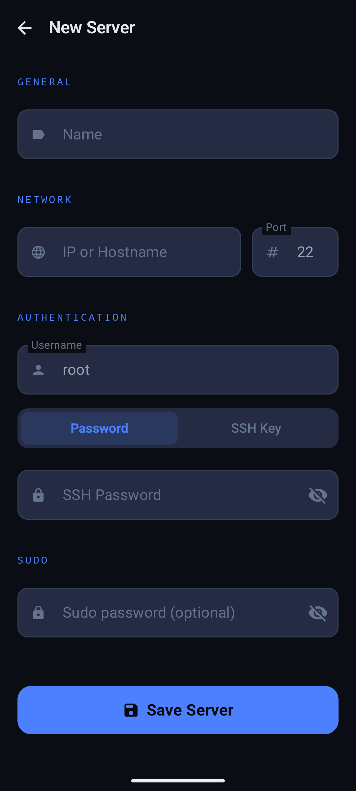
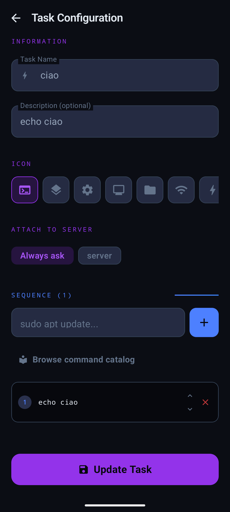
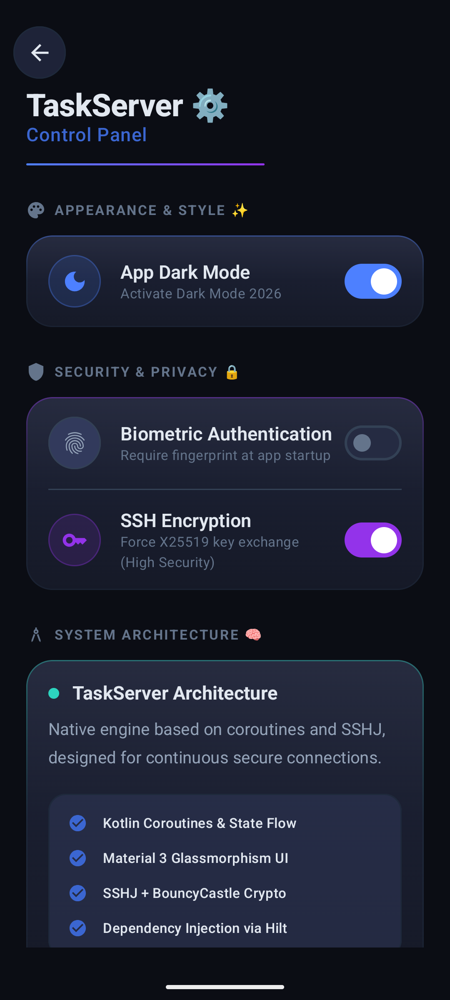
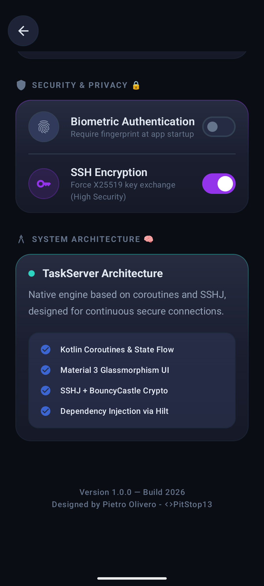
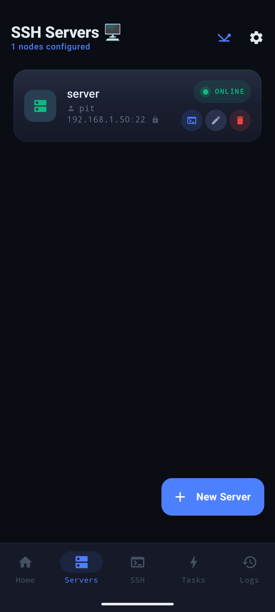
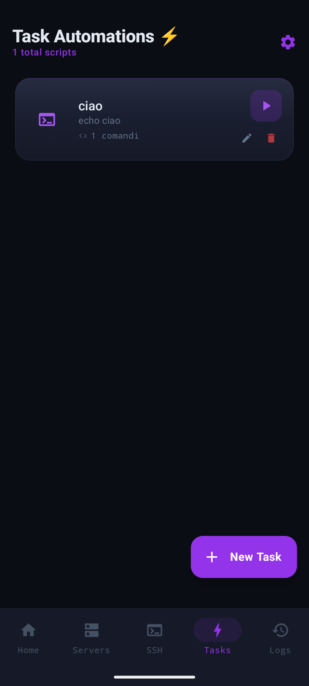
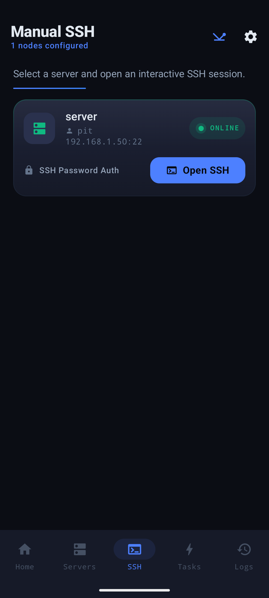
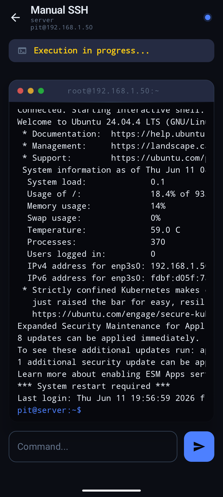
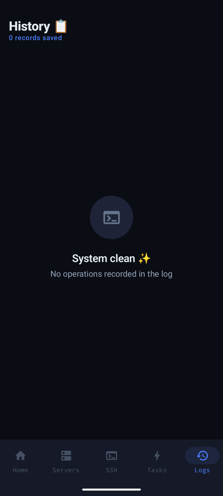

# 📱 Task Server
> **Automate your SSH workflow. Control your servers from anywhere.**

Task Server is an Android app designed by **Pietro Olivero** for anyone who manages servers and wants to eliminate repetitive typing. Save your servers, define your most-used tasks, and execute them with a single tap — or drop into a full interactive SSH terminal with ANSI color and virtual keyboard support whenever you need complete control.

---

## ⚡ Quick Links

  
  &nbsp;&nbsp;&nbsp;&nbsp;
  
  &nbsp;&nbsp;&nbsp;&nbsp;
  

  💡 <b>Just want the app?</b> Click the green button to grab the latest <code>.apk</code> instantly from GitHub Releases.

---

## ✨ Features

- 🖥️ **Server Presets & Live Health Monitoring** — Save host, port, and credentials once. Real-time background connectivity polling continuously monitors server availability (Online, Offline, Checking).
- ⚡ **One-Tap Task Automation** — Define multi-command shell scripts and launch them in a single tap. Preserves working directory changes (`cd`) and supports fail-fast execution (`set -e`).
- 💻 **Interactive SSH Terminal (xterm.js)** — Full-featured interactive terminal with VT100/ANSI color support, dynamic resizing, and a dedicated mobile accessory keyboard bar (ESC, TAB, arrow navigation, Ctrl+C).
- 🔐 **Biometric Security & Encrypted Vault** — Secure your credentials with Fingerprint/Face Unlock via AndroidX Biometric. All SSH passwords and private keys are encrypted at rest with Android Keystore & EncryptedSharedPreferences.
- 🛡️ **Sudo Support** — Seamlessly execute privileged commands with automated sudo password injection.
- 📜 **Audit History & Activity Logs** — Track executed tasks with timestamps, exit codes, and detailed output logs.
- 📦 **Lightweight & Modern** — Fast Material 3 interface built with Jetpack Compose, featuring native dark and light mode themes.

---

## 🎯 Who is this for?
Anyone who manages servers from their phone:
- **Homelab enthusiasts** — restart services, check disk space, reboot machines
- **Developers** — deploy, restart daemons, tail logs on the go
- **NAS / home server owners** — quick maintenance without sitting at a desk
- **SysAdmins** — run common scripts without opening a laptop

---

## 📸 Screenshots

### 🛠️ Main Overview & Configuration
| Home | New Server | Edit/New Task | Settings | Settings |
| :---: | :---: | :---: | :---: | :---: |
|  |  |  |  |  |

### 💻 Connection & Management
| Servers List | Tasks List | SSH Dashboard | SSH Terminal | Activity Logs |
| :---: | :---: | :---: | :---: | :---: |
|  |  |  |  |  |

---

## 🛠️ Built With

- **Language:** Kotlin 2.1
- **UI Toolkit:** Jetpack Compose & Material 3
- **Architecture:** MVVM + Clean Architecture with Kotlin Coroutines & StateFlow
- **Dependency Injection:** Dagger Hilt
- **Local Database:** Room
- **Security:** AndroidX Biometric & EncryptedSharedPreferences
- **SSH & Cryptography:** SSHJ & BouncyCastle
- **Terminal Core:** xterm.js inside WebView with bidirectional byte streaming
- **Minimum Requirements:** Android 8.0 (API Level 26) or higher

---

## 🚀 How to Install

1. **Download:** Click the [Latest APK](https://github.com/PitStop13/Task_Server/releases/latest) button at the top of this page.
2. **Permissions:** Enable *Install from unknown sources* in your Android settings if prompted.
3. **Launch:** Install the file and you're good to go — no account required.

---

## 🤝 Contributing
Found a bug? Have a feature idea? Open an [Issue](https://github.com/PitStop13/Task_Server/issues) or submit a Pull Request. All contributions are welcome!

---

## 📄 License
MIT License — Copyright (c) 2026 **Pietro Olivero** (Main Developer & Designer).
Free to use, modify and distribute.
